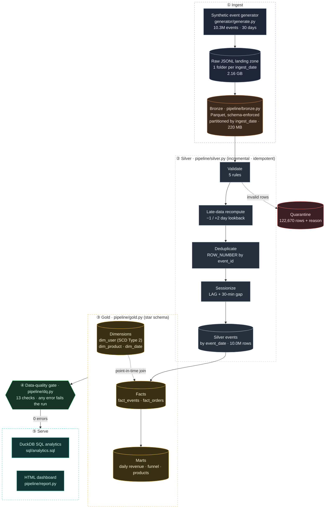
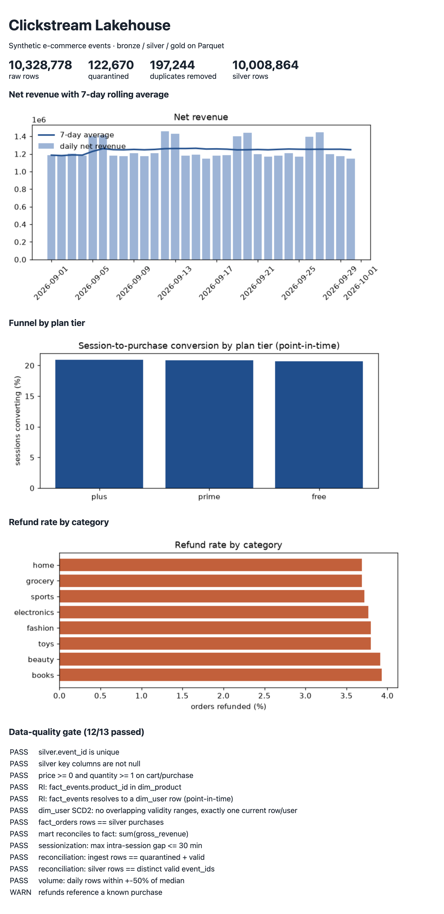

# Clickstream Lakehouse

[](https://github.com/Adityaarvind19/clickstream-lakehouse/actions/workflows/ci.yml)

An end-to-end, batch **ETL pipeline and data warehouse** for e-commerce clickstream data, built on
**PySpark + Parquet** (medallion architecture: bronze → silver → gold), a **star schema with an
SCD Type 2 dimension**, a **13-check data-quality gate**, a **SQL serving layer (DuckDB)** and an
**HTML reporting dashboard**. It processes **10.3M events (2.16 GB raw JSON)** end to end in
**2.6 minutes** on a MacBook Air (Apple M5, 16 GB), with Spark limited to 2 cores.

The input is a seeded **synthetic** dataset that deliberately contains the problems real event data
has: duplicates, re-deliveries, late-arriving events, malformed records and heavy-tailed users.

## Architecture



## Measured results (full 10M run)

Machine: MacBook Air, Apple M5, 16 GB RAM, Spark `local[2]` (2 cores), 4 GB driver, Python 3.14, OpenJDK 17.
Every number below comes from the files in [`docs/results/`](docs/results/).



| Metric | Value | Evidence |
|---|---|---|
| Raw events ingested | **10,328,778** (2.16 GB JSONL, 30 daily partitions) | [`pipeline_metrics.json`](docs/results/pipeline_metrics.json) |
| Rows quarantined (5 rule types) | **122,670** (1.19%) | [`pipeline_metrics.json`](docs/results/pipeline_metrics.json) |
| Duplicates removed (exactly-once by `event_id`) | **197,244** | [`pipeline_metrics.json`](docs/results/pipeline_metrics.json) |
| Clean silver rows / sessions derived | **10,008,864** / **2,239,625** | [`pipeline_metrics.json`](docs/results/pipeline_metrics.json) |
| Pipeline runtime (bronze 24 s, silver 83 s, gold 35 s, DQ 14 s) | **156 s ≈ 2.6 min** (~66K rows/s) | [`pipeline_metrics.json`](docs/results/pipeline_metrics.json) |
| Storage: raw JSON → bronze Parquet (Snappy) | **9.8× smaller** (2.16 GB → 220 MB) | [`benchmark.json`](docs/results/benchmark.json) |
| 7-day revenue query: raw JSON vs silver Parquet | **17.9× faster** (302 ms → 16.9 ms, median of 5) | [`benchmark.json`](docs/results/benchmark.json) |
| 1-day query: partition pruning vs no pruning | **5.0× faster** (31.2 ms → 6.3 ms) | [`benchmark.json`](docs/results/benchmark.json) |
| Analytics SQL over gold (6 queries) | each **< 50 ms** | [`warehouse_queries.json`](docs/results/warehouse_queries.json) |
| Data-quality gate | **13 checks**: 12 pass, 1 warning, 0 errors | [`dq_report.json`](docs/results/dq_report.json) |
| Tests | **5 passed** (incl. end-to-end idempotency + incremental re-run) | [`test_output.txt`](docs/results/test_output.txt), CI badge above |

Runtime is the sum of stage times and excludes Spark JVM start-up (a few seconds).
Benchmarks depend on hardware: on a 2-core cloud VM the same run took 5.3 min and the JSON-vs-Parquet
speedup was 27.7×, because slower JSON parsing widens the gap.

## Design decisions (the interview talking points)

**Idempotency.** Every stage writes with Spark *dynamic partition overwrite*, so re-running any
date range replaces exactly those partitions — no duplicates, no manual cleanup. The end-to-end test
runs the whole pipeline twice and asserts identical outputs.

**Late-arriving data.** A day's file can contain events from up to 2 days earlier (late) and from
just after midnight (next date). Overwriting a silver partition with only the newest rows would
silently lose data, so silver recomputes every *affected* `event_date` from all bronze partitions
that could hold it (1 day before … 2 days after) and overwrites them atomically.
*This was a real bug found during testing:* the first version only looked backwards and a single-day
re-run dropped 290 of 10M rows. The fix plus a regression test are in the repo.

**Never drop data silently.** Invalid rows go to a quarantine table with the first rule they
violate (`NULL_USER`, `BAD_TIMESTAMP`, `INVALID_EVENT_TYPE`, `NEGATIVE_PRICE`, `UNKNOWN_PRODUCT`,
`CORRUPT_RECORD`, `NULL_EVENT_ID`). Two reconciliation checks prove
`ingested = quarantined + valid` and `silver rows = distinct valid event_ids`.

**Point-in-time correctness (SCD Type 2).** Users change plan tier (free/plus/prime). `dim_user`
keeps every version with `valid_from / valid_to / is_current`; facts join on
`event_date BETWEEN valid_from AND valid_to`, so revenue is attributed to the tier the user had *at
order time*, not today. `sql/analytics.sql → plan_tier_point_in_time_vs_current` shows the difference.

**The DQ gate catches real problems.** On the first 10M run the referential-integrity check failed on
4 rows: late events dated *before* their user's signup — a flaw in the synthetic generator. The gate
stopped the run; the generator was fixed at the source rather than weakening the check.

**Sessionization.** Window functions (`lag` + running `sum`) start a new session after 30 minutes of
inactivity; a DQ check asserts no intra-session gap exceeds 30 minutes. Sessions are cut at UTC
midnight (documented limitation).

## Data model (gold)

| Table | Grain | Notes |
|---|---|---|
| `fact_events` | one row per clean event | partitioned by `event_date`; `user_sk` resolved point-in-time |
| `fact_orders` | one row per purchase | refund netted (`gross`, `refund`, `net`), partitioned by `order_date` |
| `dim_user` | one row per user *version* | SCD Type 2 on `plan_tier` |
| `dim_product`, `dim_date` | product / calendar day | |
| `agg_daily_revenue`, `agg_funnel_daily`, `agg_product_daily` | daily marts | feed the dashboard |

`sql/redshift_ddl.sql` shows how the same model would be laid out on Amazon Redshift
(`DISTSTYLE ALL` dimensions, `DISTKEY/SORTKEY` on the fact, `COPY … FORMAT AS PARQUET`).
*It is reference DDL and is not deployed by this repo.*

## AWS mapping

The code uses plain paths; pointing `LAKE_ROOT` at `s3a://…` (with hadoop-aws) is the only change
needed to run on S3. Not deployed to AWS in this repo.

| Here (local) | On AWS |
|---|---|
| filesystem lake (`data/lake/...`) | Amazon S3 |
| PySpark job (`pipeline/*.py`) | AWS Glue job or Amazon EMR step |
| DuckDB views over Parquet | Amazon Athena / Redshift Spectrum |
| gold star schema | Amazon Redshift |
| `make pipeline` | Glue workflow / Step Functions / MWAA (Airflow) |

## Run it

Requires Python 3.10+ and Java 17+.

```bash
pip install -r requirements.txt
make data          # ~2.5 min: 10M synthetic events  (EVENTS=1000000 make data for a quick run)
make pipeline      # bronze -> silver -> gold -> DQ gate
make warehouse     # analytics SQL over gold
make benchmark     # storage + query benchmarks
make report        # data/reports/dashboard.html
make test          # 5 tests, ~2 min
```

Incremental / backfill:

```bash
python -m pipeline.run bronze --from 2026-09-15 --to 2026-09-15
python -m pipeline.run silver --from 2026-09-15 --to 2026-09-15
python -m pipeline.run gold
```

## Repository layout

```
generator/generate.py     synthetic data with duplicates, late + malformed events
pipeline/config.py        paths, constants, Spark session
pipeline/transforms.py    pure DataFrame transforms (unit-tested)
pipeline/bronze.py        raw -> bronze
pipeline/silver.py        bronze -> silver (+ quarantine)
pipeline/gold.py          silver -> star schema + marts
pipeline/dq.py            data-quality gate
pipeline/warehouse.py     DuckDB serving layer
pipeline/benchmark.py     storage / query benchmarks
pipeline/report.py        HTML dashboard
sql/analytics.sql         window functions, top-N per group, funnel, SCD2 comparison
sql/redshift_ddl.sql      reference Redshift DDL
tests/test_pipeline.py    unit + end-to-end tests
docs/results/             metrics, benchmarks, DQ report, tests and dashboard from the 10M run
.github/workflows/ci.yml  GitHub Actions: install + pytest
```

## Limitations

* Synthetic data; distributions are plausible, not real. Plan tiers show no conversion difference
  because the generator does not model one.
* Single-node Spark (`local[2]`); it has not been run on a cluster.
* Gold is rebuilt from silver on each run (silver is the incremental layer).
* Sessions are cut at UTC midnight.
